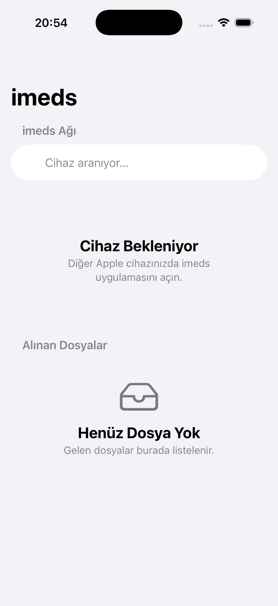
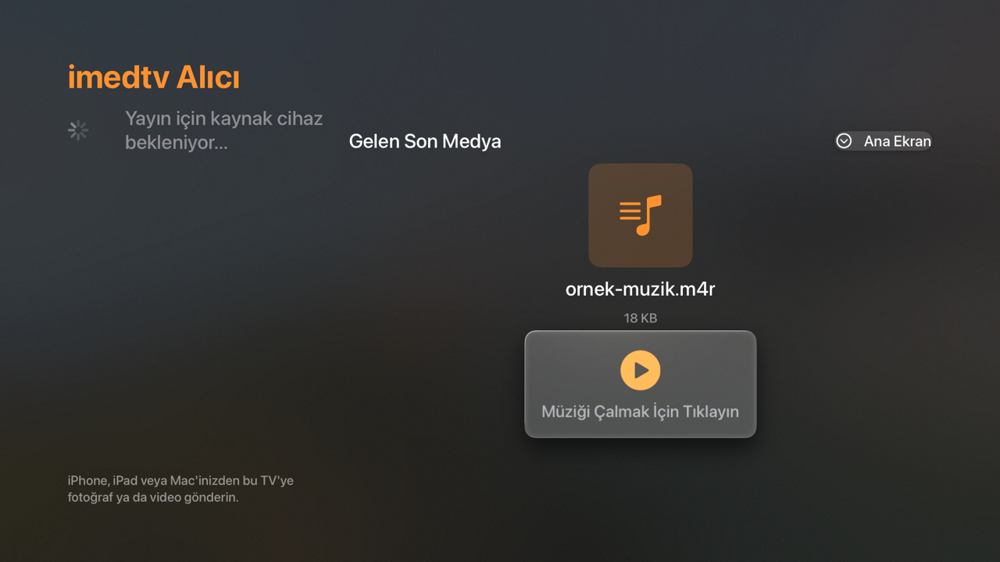
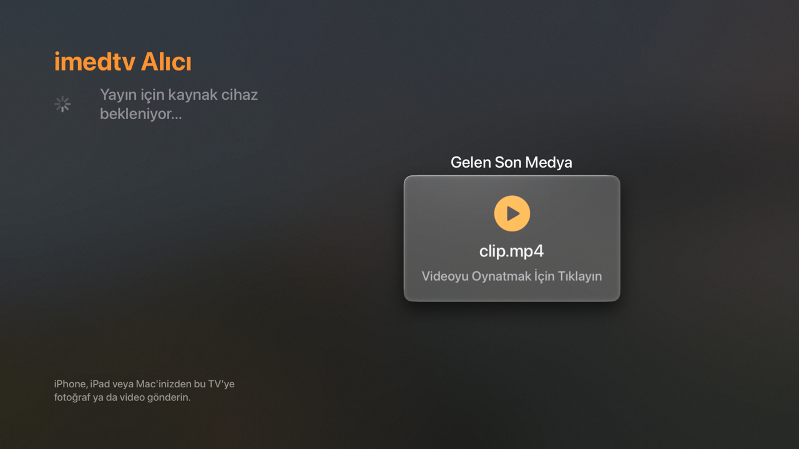
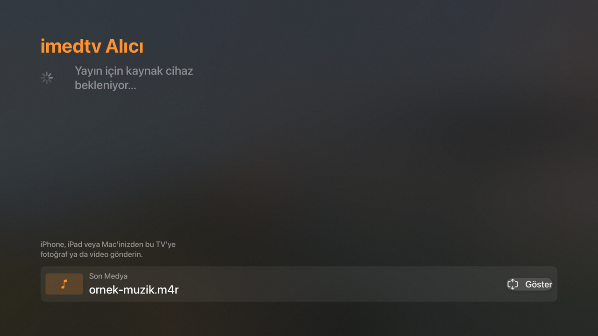

<p align="center">
  
  &nbsp;&nbsp;&nbsp;
  
</p>

<h1 align="center">imeds</h1>

<p align="center">
  Send photos, videos, music and any file from iPhone / iPad to Apple TV
  <strong>without internet</strong>, over your local network.
</p>

<p align="center">
  <a href="https://talatozunal.github.io/imeds/"><strong>Website →</strong></a>
</p>

<p align="center">
  
  
  
  
  
</p>

<p align="center">
  <a href="README.md">Türkçe</a> · <a href="#installation">Installation</a> ·
  <a href="#usage">Usage</a> · <a href="CHANGELOG.md">Changelog</a>
</p>

---

## What is imeds?

**imeds** is a SwiftUI project for moving files between two Apple devices.
It needs no server, cloud, account or internet connection. Devices discover each
other on the local network (Wi-Fi / Bluetooth) and transfer files directly,
peer to peer, inside an encrypted MultipeerConnectivity session.

| Target | Platform | Role |
| --- | --- | --- |
| **imeds** | iOS 17+ | Sender UI (iPhone / iPad) |
| **imedtv** | tvOS 17+ | Apple TV receiver and media player |

Typical flow: pick a video on your phone, your Apple TV appears in the list,
send it, and the video plays on the TV. When playback is done, the app stays on
the main screen with the last media pinned at the bottom, ready for the next file.

## Features

- **No internet** — same Wi-Fi network or nearby Bluetooth is enough.
- **Encrypted session** — `MCSession` uses `encryptionPreference: .required`.
- **Two-way discovery** — both apps advertise and browse at the same time.
- **Photo / video picking** via the system PHPicker.
- **File picking** from the Files app.
- **Live progress** — percentage, transferred / total bytes and smoothed `MB/s`.
- **Cancel** — transfers can be cancelled from either iPhone or Apple TV.
- **Reconnect after cancel** — known peers are re-invited in stages.
- **Safe file names** — path traversal blocked, duplicate names made unique.
- **Persistent storage** — files live in `Documents/Received/` and are visible
  in the Files app.
- **Photo library save** — received photos and videos can be added to Photos.
- **Apple TV playback** — dedicated UI for images, videos and audio.
- **Last media bar** — Back does not quit the app; it collapses the player.
- **Preparation state** — "Preparing media..." while iCloud downloads or converts.
- **No sleep during transfer** — the iPhone screen stays awake so Wi-Fi does not slow down.
- **Zero dependencies** — Apple frameworks only.
- **Five languages** — Turkish, English, German, French and Italian, switchable
  in-app without restarting.

## Screenshots

| iPhone — sender | Apple TV — audio playback |
| --- | --- |
|  |  |

| Apple TV — video | Apple TV — last media bar |
| --- | --- |
|  |  |

## How it works

### Connection

Both apps advertise themselves with `MCNearbyServiceAdvertiser` and browse with
`MCNearbyServiceBrowser`. The Bonjour service type is `imeds-transfer` on both
sides.

To avoid both devices inviting each other at the same time, the side whose
display name sorts first invites immediately; the other side retries once after
6 seconds. If a connection still cannot be established, the invitation is
retried once more after 16 seconds.

### Transfer

- Sending uses `MCSession.sendResource(at:withName:toPeer:)`.
- The returned `Progress` is observed via KVO; the UI refreshes about 6 times
  per second.
- If the receiver gets `totalUnitCount == 0`, the total size is derived from
  `completed / fraction`, so the percentage still works.
- Speed is a smoothed average of recent samples.
- Cancel calls `Progress.cancel()`; the browser and session are left intact.
  Cancellation-related "Resource transfer cancelled" and "Peer no longer
  connected" errors are hidden from the user.

### Storage

Received files are written to the first writable location:

1. `Documents/Received/`
2. `Application Support/Received/`
3. `tmp/Received/`

If moving fails, the app falls back to copying and then to an in-memory write.
Incoming names go through `lastPathComponent`, `../` traversal is neutralised,
and duplicates become `file_1.ext`, `file_2.ext`.

## Requirements

- macOS and **Xcode 16+** (tested with Xcode 26)
- **iOS 17+** iPhone or iPad
- **tvOS 17+** Apple TV
- Both devices on the same Wi-Fi network (or within Bluetooth range)
- **Local Network** permission on first launch

> No internet connection is required. Nothing is uploaded anywhere: there is
> no analytics, advertising or account system.

## Installation

```bash
git clone https://github.com/talatozunal/imeds.git
cd imeds
open imeds.xcodeproj
```

### Signing

`DEVELOPMENT_TEAM` is intentionally **not** committed to this public repository.
For each target in Xcode:

1. Select the target (`imeds` or `imedtv`).
2. Open **Signing & Capabilities**.
3. Choose your Apple developer team under **Team**.

Change `PRODUCT_BUNDLE_IDENTIFIER` (`com.talat.imeds`, `com.talat.imedtv`) to
your own identifiers if needed. The two apps must use different bundle IDs.

### Command-line build

```bash
# iPhone / iPad
xcodebuild -project imeds.xcodeproj -scheme imeds \
  -sdk iphonesimulator -destination 'generic/platform=iOS Simulator' \
  CODE_SIGNING_ALLOWED=NO build

# Apple TV
xcodebuild -project imeds.xcodeproj -scheme imedtv \
  -sdk appletvsimulator -destination 'generic/platform=tvOS Simulator' \
  CODE_SIGNING_ALLOWED=NO build
```

## Usage

### iPhone / iPad

1. Open **imedtv** on the Apple TV.
2. Open **imeds** on the iPhone.
3. Your Apple TV appears under **imeds Network**.
4. Tap **Choose Photo / Video** or **Choose File**.
5. If preparation is needed, "Preparing media..." is shown, then the transfer
   starts.
6. The transfer card shows percentage, size and speed. Tap **Cancel** to cancel.

### Apple TV

- A new file automatically opens in the right-hand panel.
- **Images** are displayed directly.
- **Videos** are validated with `AVURLAsset` (`isPlayable` plus a video track)
  and played inline.
- **Audio** files get a music card with a duration bar and **Play / Pause**.
- While a player is open, the remote's **Back** button does not quit the app;
  the media collapses into the **Latest Media** bar at the bottom.
- **Show** expands it again. On the main screen, Back behaves normally and
  exits the app.
- When a new file arrives, the large view opens automatically.

## Language support

The interface ships in five languages: **Turkish, English, German, French and
Italian**. It follows the device language by default.

- **iPhone / iPad:** tap the **Language** row at the bottom of the list.
- **Apple TV:** select the **Language** button next to the title.

The choice is stored in `UserDefaults` and applied to every screen without
restarting the app. Translations live in `Localizable.strings` inside the
`tr.lproj`, `en.lproj`, `de.lproj`, `fr.lproj` and `it.lproj` folders. To add a
language, create a new `.lproj` folder with the same keys, add its code to
`UygulamaDili`, and list it in `desteklenenDiller` in `Dil.swift`.

## Supported file types

| Kind | Extensions | Apple TV behaviour |
| --- | --- | --- |
| Image | `jpg`, `jpeg`, `png`, `heic`, `heif`, `gif`, `webp`, `tiff`, `bmp` | Shown in the right panel |
| Video | `mp4`, `mov`, `m4v`, `avi`, `mkv`, `webm`, `3gp`, `mpg`, `mpeg`, `ts` | Validated and played |
| Audio | `mp3`, `wav`, `m4a`, `m4r`, `aac`, `flac`, `aiff`, `aif`, `caf`, `ogg`, `opus`, `wma`, `alac` | Played with the music card |
| Other | Any file | File icon and name |

Unknown extensions are also checked with `UniformTypeIdentifiers`
(`UTType.image`, `.movie`, `.video`, `.audio`). Video playback depends on the
**codec**: even though `.avi` / `.mkv` containers are recognised, codecs such as
DivX/Xvid cannot be decoded by AVFoundation. In that case the reason is shown
on screen instead of failing silently.

## Network and permissions

Permissions are declared in `Info.plist` and `Info-tvOS.plist`:

| Key | Purpose |
| --- | --- |
| `NSLocalNetworkUsageDescription` | Discover nearby Apple devices |
| `NSBonjourServices` | `_imeds-transfer._tcp`, `_imeds-transfer._udp` |
| `NSPhotoLibraryAddUsageDescription` | Save received photos/videos (iOS) |
| `UIFileSharingEnabled` | Expose received files in the Files app (iOS) |

Bonjour service type: **`imeds-transfer`**. It must stay identical in both
targets; update both apps together if you change it.

## Project layout

```text
.
├── imeds.xcodeproj/            # two targets: imeds (iOS) + imedtv (tvOS)
├── ImedsApp.swift              # entry point, platform-specific root view
├── Models.swift                # SharedFile, media type detection
├── NetworkManager.swift        # MultipeerConnectivity, transfer, storage
├── ContentView.swift           # iOS UI
├── AppleTVView.swift           # tvOS UI + video/audio players
├── FilePicker.swift            # PHPicker and Files bridge
├── Dil.swift                   # language manager and DilSecici
├── tr|en|de|fr|it.lproj/       # Localizable.strings + InfoPlist.strings
├── Info.plist                  # iOS permissions
├── Info-tvOS.plist             # tvOS permissions
├── imeds/Assets.xcassets/      # app icons for iOS and tvOS
├── Tools/make-icons.swift      # icon generator
├── docs/                       # screenshots and extra docs
├── CHANGELOG.md
├── CONTRIBUTING.md
└── SECURITY.md
```

## Troubleshooting

**The Apple TV does not appear in the list**

- Make sure both devices are on the same Wi-Fi network.
- Check that **Local Network** permission is granted on both apps
  (Settings → Privacy & Security → Local Network).
- Keep imedtv open on the Apple TV.
- Toggle Bluetooth off and on to restart discovery.

**Transfers are slow**

- 5 GHz Wi-Fi and close proximity are noticeably faster.
- Keep the iPhone screen on; the app already prevents sleep during a transfer.
- A very large video may still be downloading from iCloud first, which is why
  "Medya hazırlanıyor..." can take a while.
- Speed depends on the MultipeerConnectivity transport; a few MB/s between
  devices is normal.

**A video will not play**

- Read the error on screen. It may be an unsupported codec (e.g. DivX) or a
  corrupted file.
- `.mp4` and `.mov` files with H.264 / HEVC are the most reliable.

**An audio file will not play**

- Check the supported extension list. `.m4r`, `.mp3`, `.wav` and `.m4a` have
  been tested.
- Corrupted or DRM-protected files cannot be played; the reason is shown.

**"No folder to save into" error**

- The app recreates the folder on every receive and falls back to
  `Application Support` or `tmp`. If the problem persists, restart the app.

**The connection looks broken after cancelling**

- Known peers are re-invited after 1.5, 4, 8 and 14 seconds. It usually recovers
  within a few seconds.

## Known limitations

- Only **one transfer at a time**; there is no queue yet.
- Transfer speed depends on the Wi-Fi/Bluetooth transport.
- No Share Extension; sending starts inside the app.
- Local network only; no transfers over the internet or remote networks.
- Not distributed on the App Store; build it from source.
- The UI is currently Turkish only.

## Roadmap

- [ ] Share Extension for sending directly from the Files app
- [ ] Queue for multiple files
- [ ] Video thumbnails and a media library view
- [ ] English UI and localisation infrastructure
- [ ] Transfer history and search
- [ ] Dedicated iPad layout

## Contributing

Contributions are welcome. Please read [CONTRIBUTING.md](CONTRIBUTING.md) first.
Use the GitHub issue templates for bug reports.

Report security issues privately as described in [SECURITY.md](SECURITY.md)
instead of opening a public issue.

## License

[MIT](LICENSE) © 2026 Talat Özünal

See [docs/ICONS.md](docs/ICONS.md) for icon generation and asset structure.
