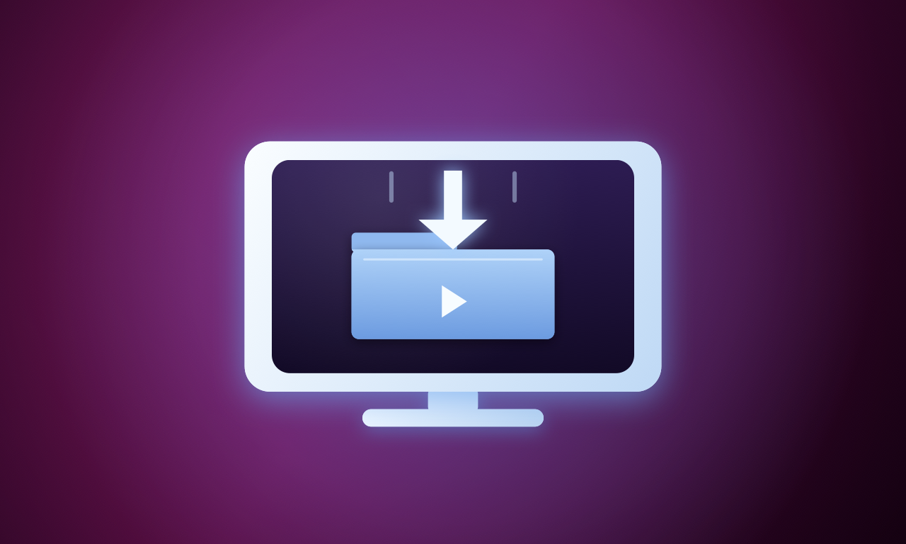
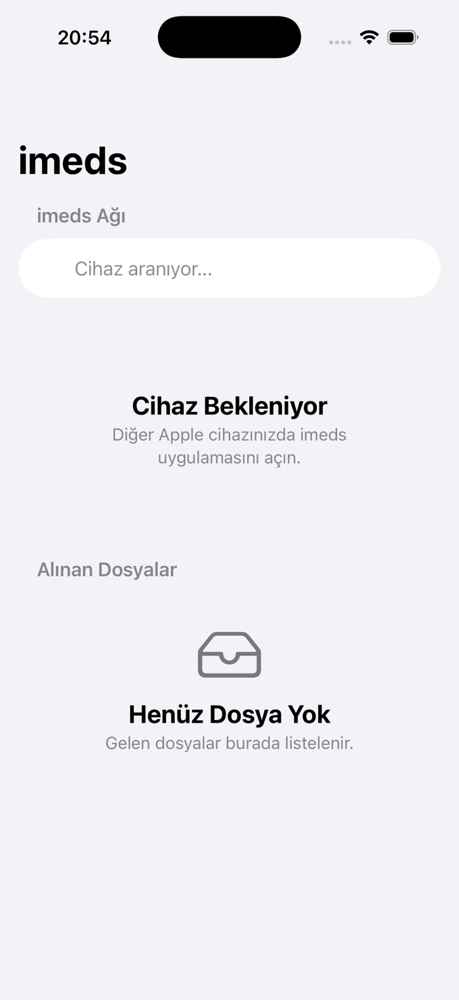
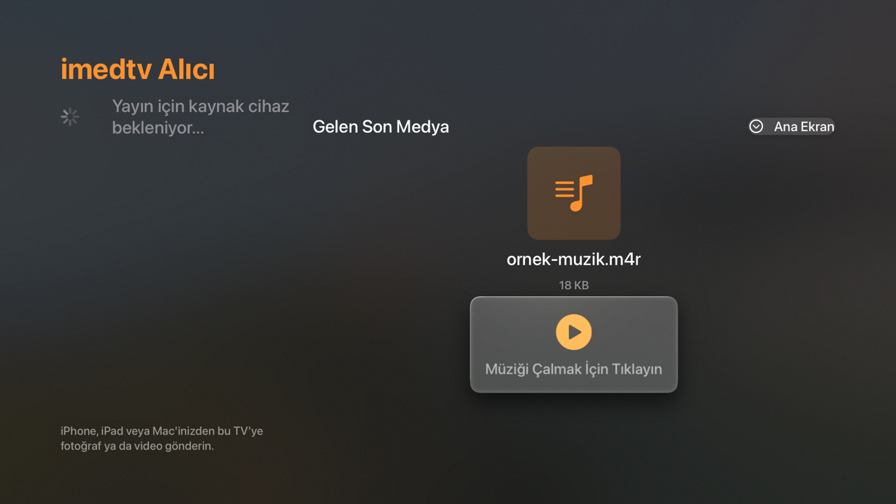
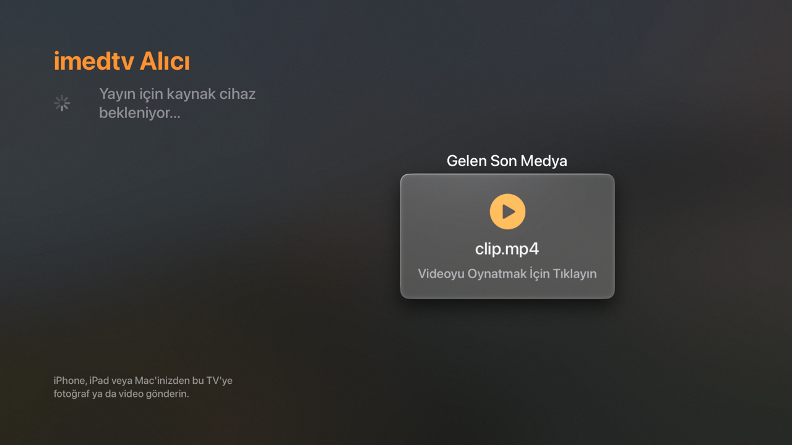
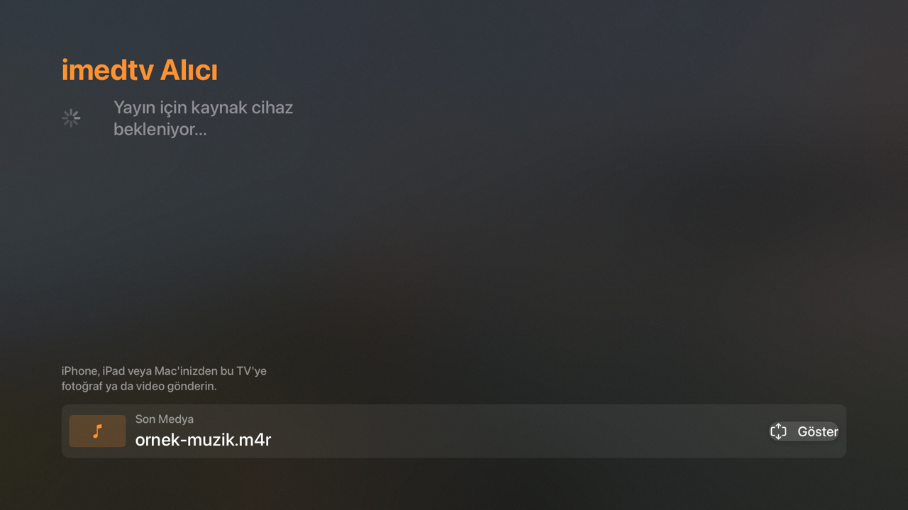

<p align="center">
  
  &nbsp;&nbsp;&nbsp;
  
</p>

<h1 align="center">imeds</h1>

<p align="center">
  iPhone / iPad'den Apple TV'ye <strong>internet olmadan</strong>, aynı yerel ağ
  üzerinden fotoğraf, video, müzik ve dosya aktarımı.
</p>

<p align="center">
  
  
  
  
  
</p>

<p align="center">
  <a href="README.en.md">English</a> · <a href="#kurulum">Kurulum</a> ·
  <a href="#kullan%C4%B1m">Kullanım</a> · <a href="CHANGELOG.md">Değişiklikler</a>
</p>

---

## imeds nedir?

**imeds**, iki Apple cihazı arasında dosya taşımak için yazılmış bir SwiftUI
projesidir. Sunucu, bulut, hesap veya internet bağlantısı gerektirmez.
Cihazlar birbirini yerel ağda (Wi-Fi / Bluetooth) bulur ve aktarımı doğrudan
cihazdan cihaza, şifreli bir MultipeerConnectivity oturumu üzerinden yapar.

| Hedef | Platform | Görev |
| --- | --- | --- |
| **imeds** | iOS 17+ | Gönderici arayüzü (iPhone / iPad) |
| **imedtv** | tvOS 17+ | Apple TV alıcı ekranı, medya oynatıcı |

Temel kullanım senaryosu: telefonunuzdaki bir videoyu seçersiniz, Apple TV
cihazınız ekranda belirir, gönderirsiniz ve video Apple TV'de oynar. İşlem
bittiğinde Apple TV ana ekranında kalır ve yeni dosya almaya hazır olur.

## Özellikler

- **İnternetsiz aktarım** — aynı Wi-Fi ağı veya yakın Bluetooth yeterli.
- **Şifreli oturum** — `MCSession` `encryptionPreference: .required` ile kurulur.
- **Çift yönlü keşif** — her iki uygulama aynı anda hem yayın yapar hem tarar.
- **Fotoğraf / video seçimi** — sistem PHPicker'ı ile.
- **Dosya seçimi** — Files uygulamasından her tür dosya.
- **Canlı ilerleme** — yüzde, `aktarılan / toplam` boyut ve anlık `MB/sn`.
- **Vazgeç** — aktarım hem iPhone'da hem Apple TV'de iptal edilebilir.
- **Kopmaya dayanıklı** — iptal sonrası bilinen eşlere kademeli yeniden davet.
- **Güvenli dosya adları** — path traversal engeli ve otomatik benzersiz ad.
- **Kalıcı arşiv** — dosyalar `Documents/Received/` altında saklanır; Files
  uygulamasından erişilebilir.
- **Galeriye kayıt** — alınan fotoğraf ve videolar isteğe bağlı olarak galeriye
  eklenir.
- **Apple TV'de oynatma** — resim, video ve ses dosyaları için ayrı arayüzler.
- **Son medya alt şeritte** — Geri tuşu uygulamadan çıkarmaz; medya küçülür.
- **Hazırlık durumu** — iCloud'dan indirme/dönüştürme sırasında
  "Medya hazırlanıyor..." gösterilir.
- **Uyku engeli** — aktarım sırasında iPhone ekranı kapanmaz, Wi-Fi yavaşlamaz.
- **Sıfır bağımlılık** — yalnızca Apple çatısı; harici paket yok.

## Ekran görüntüleri

| iPhone — gönderim | Apple TV — ses oynatma |
| --- | --- |
|  |  |

| Apple TV — video | Apple TV — son medya şeridi |
| --- | --- |
|  |  |

## Nasıl çalışır?

### Bağlantı

Her iki uygulama da `MCNearbyServiceAdvertiser` ile kendini yayınlar ve
`MCNearbyServiceBrowser` ile çevreyi tarar. Bonjour servis tipi iki tarafta da
`imeds-transfer` olarak sabittir.

İki cihazın aynı anda birbirini davet etmesini önlemek için görünen ada göre
"küçük" olan taraf hemen davet gönderir; diğer taraf 6 saniye içinde bağlantı
kurulmazsa bir kez kendisi dener. 16 saniye içinde bağlantı kurulamazsa davet
bir kez daha yinelenir.

### Aktarım

- Gönderim `MCSession.sendResource(at:withName:toPeer:)` ile yapılır.
- Dönen `Progress` nesnesi KVO ile izlenir; arayüz saniyede ~6 kez güncellenir.
- Alım tarafında `totalUnitCount` sıfır gelirse toplam boyut
  `tamamlanan / oran` üzerinden hesaplanır, yüzde yine görünür.
- Hız, son örneklerin yumuşatılmış ortalamasıdır.
- İptal, `Progress.cancel()` çağrısıyla yapılır; tarayıcı veya oturum yeniden
  oluşturulmaz. İptal kaynaklı "Resource transfer cancelled" ve
  "Peer no longer connected" hataları kullanıcıya gösterilmez.

### Dosya saklama

Alınan dosyalar sırasıyla şu konumlara yazılır:

1. `Documents/Received/`
2. `Application Support/Received/`
3. `tmp/Received/`

Yazma testinden geçen ilk klasör kullanılır. Dosya taşınamazsa kopyalama, o da
olmazsa belleğe okuyup yazma denenir. Gelen adlar `lastPathComponent` ile
temizlenir, `../` gibi girişimler etkisizleştirilir ve aynı adlı dosyalar
`dosya_1.ext`, `dosya_2.ext` biçiminde benzersizleştirilir.

## Gereksinimler

- macOS ve **Xcode 16+** (Xcode 26 ile test edildi)
- **iOS 17+** iPhone veya iPad
- **tvOS 17+** Apple TV
- Cihazların aynı Wi-Fi ağında olması (veya Bluetooth menzilinde)
- İlk çalıştırmada **Yerel Ağ** izni

> Internet bağlantısı gerekmez. Uygulama hiçbir veriyi dışarıya göndermez;
> analitik, reklam veya hesap sistemi yoktur.

## Kurulum

```bash
git clone https://github.com/<kullanici>/imeds.git
cd imeds
open imeds.xcodeproj
```

### İmzalama

Herkese açık depoda `DEVELOPMENT_TEAM` bilgisi bilinçli olarak **tutulmaz**.
Xcode'da her iki hedef için:

1. Hedefi seçin (`imeds` veya `imedtv`).
2. **Signing & Capabilities** sekmesine gidin.
3. **Team** alanından kendi Apple geliştirici takımınızı seçin.

Gerekirse `PRODUCT_BUNDLE_IDENTIFIER` değerlerini (`com.talat.imeds`,
`com.talat.imedtv`) kendi tanımlayıcılarınızla değiştirin. İki uygulama farklı
paket kimlikleri kullanmalıdır.

### Komut satırından derleme

```bash
# iPhone / iPad
xcodebuild -project imeds.xcodeproj -scheme imeds \
  -sdk iphonesimulator -destination 'generic/platform=iOS Simulator' \
  CODE_SIGNING_ALLOWED=NO build

# Apple TV
xcodebuild -project imeds.xcodeproj -scheme imedtv \
  -sdk appletvsimulator -destination 'generic/platform=tvOS Simulator' \
  CODE_SIGNING_ALLOWED=NO build
```

## Kullanım

### iPhone / iPad

1. Apple TV'de **imedtv** uygulamasını açın.
2. iPhone'da **imeds** uygulamasını açın.
3. **imeds Ağı** bölümünde Apple TV cihazınız belirir.
4. **Fotoğraf / Video Seç** veya **Dosya Seç** ile göndermek istediğinizi seçin.
5. Seçimden sonra hazırlık gerekirse "Medya hazırlanıyor..." görünür; ardından
   aktarım başlar.
6. Aktarım kartında yüzde, boyut ve hız görünür. **Vazgeç** ile iptal edebilirsiniz.

### Apple TV

- Yeni dosya geldiğinde medya otomatik olarak sağ panelde açılır.
- **Resim** doğrudan gösterilir.
- **Video** `AVURLAsset` ile doğrulanır (`isPlayable` + video izi) ve oynatıcı
  sağ panelde açılır.
- **Ses** dosyaları için süre çubuğu ve **Oynat / Duraklat** düğmesi olan müzik
  kartı gösterilir.
- Oynatıcı açıkken kumandanın **Geri** tuşuna basmak uygulamadan çıkarmaz;
  medya küçülür ve ekranın altındaki **Son Medya** şeridinde kalır.
- **Göster** düğmesiyle tekrar büyütülür. Ana ekranda iken Geri tuşu normal
  şekilde uygulamadan çıkar.
- Yeni bir dosya geldiğinde büyük görünüm kendiliğinden geri açılır.

## Desteklenen dosya türleri

| Tür | Uzantılar | Apple TV davranışı |
| --- | --- | --- |
| Görsel | `jpg`, `jpeg`, `png`, `heic`, `heif`, `gif`, `webp`, `tiff`, `bmp` | Sağ panelde gösterilir |
| Video | `mp4`, `mov`, `m4v`, `avi`, `mkv`, `webm`, `3gp`, `mpg`, `mpeg`, `ts` | Doğrulanıp oynatılır |
| Ses | `mp3`, `wav`, `m4a`, `m4r`, `aac`, `flac`, `aiff`, `aif`, `caf`, `ogg`, `opus`, `wma`, `alac` | Müzik kartıyla çalınır |
| Diğer | Tüm dosyalar | Dosya simgesi ve adı gösterilir |

Listede olmayan uzantılar `UniformTypeIdentifiers` (`UTType.image`,
`.movie`, `.video`, `.audio`) ile de kontrol edilir. Video oynatma başarısı
dosyanın **codec** desteğine bağlıdır: `.avi` / `.mkv` kapsayıcısı tanınsa bile
DivX/Xvid gibi codec'ler AVFoundation tarafından çalınamaz. Bu durumda sessiz
kalmak yerine nedeni ekranda yazar.

## Ağ ve izinler

İzinler `Info.plist` ve `Info-tvOS.plist` içinde tanımlıdır:

| Anahtar | Açıklama |
| --- | --- |
| `NSLocalNetworkUsageDescription` | Yakındaki Apple cihazlarını bulma izni |
| `NSBonjourServices` | `_imeds-transfer._tcp`, `_imeds-transfer._udp` |
| `NSPhotoLibraryAddUsageDescription` | Alınan fotoğraf/videoyu galeriye ekleme (iOS) |
| `UIFileSharingEnabled` | Alınan dosyaları Files uygulamasında gösterme (iOS) |

Bonjour servis tipi: **`imeds-transfer`**. Bu değer iki uygulamada da aynı
olmalıdır; değiştirirseniz iki hedefi birlikte güncelleyin.

## Proje yapısı

```text
.
├── imeds.xcodeproj/            # iki hedef: imeds (iOS) + imedtv (tvOS)
├── ImedsApp.swift              # giriş noktası, platforma göre kök görünüm
├── Models.swift                # SharedFile, medya türü algılama
├── NetworkManager.swift        # MultipeerConnectivity, aktarım, saklama
├── ContentView.swift           # iOS arayüzü
├── AppleTVView.swift           # tvOS arayüzü + video/ses oynatıcıları
├── FilePicker.swift            # PHPicker ve Files köprüsü
├── Info.plist                  # iOS izinleri
├── Info-tvOS.plist             # tvOS izinleri
├── imeds/Assets.xcassets/      # iOS ve tvOS uygulama ikonları
├── Tools/make-icons.swift      # ikon üretim betiği
├── docs/                       # ekran görüntüleri ve ek belgeler
├── CHANGELOG.md
├── CONTRIBUTING.md
└── SECURITY.md
```

## Sorun giderme

**Apple TV cihazı listede görünmüyor**

- İki cihazın da aynı Wi-Fi ağında olduğundan emin olun.
- Her iki uygulamada **Yerel Ağ** izninin verildiğini kontrol edin
  (Ayarlar → Gizlilik ve Güvenlik → Yerel Ağ).
- Apple TV'de imedtv uygulamasının açık olduğundan emin olun.
- Bluetooth'u kapatıp açmak keşfi yeniden başlatır.

**Aktarım yavaş**

- 5 GHz Wi-Fi ve yakın mesafe belirgin biçimde daha hızlıdır.
- iPhone ekranını kapatmayın; uygulama aktarım sırasında uykuyu zaten engeller.
- Çok büyük bir video seçtiyseniz iPhone önce iCloud'dan indiriyor olabilir;
  "Medya hazırlanıyor..." adımı bu yüzden uzun sürebilir.
- Hız, MultipeerConnectivity'nin taşıma katmanına bağlıdır; cihazdan cihaza
  birkaç MB/sn normaldir.

**Video açılmıyor**

- Ekranda yazan hata metnini kontrol edin. Desteklenmeyen codec (ör. DivX)
  veya bozuk dosya olabilir.
- H.264 / HEVC içeren `.mp4` ve `.mov` dosyaları en güvenilir sonucu verir.

**Ses dosyası çalmıyor**

- Desteklenen uzantı listesini kontrol edin. `.m4r`, `.mp3`, `.wav`, `.m4a`
  test edilmiştir.
- Dosya bozuksa veya DRM korumalıysa AVFoundation çalamaz; neden ekranda yazar.

**"Kaydedilecek klasör yok" hatası**

- Uygulama klasörü her alımda yeniden oluşturur ve gerekirse
  `Application Support` veya `tmp` altına düşer. Sorun sürerse uygulamayı
  kapatıp yeniden açın.

**İptalden sonra bağlantı kopuk görünüyor**

- İptal sonrası eşlere 1.5, 4, 8 ve 14 saniyelik aralıklarla yeniden davet
  gönderilir. Birkaç saniye içinde kendiliğinden düzelir.

## Bilinen sınırlar

- Aynı anda **tek aktarım** yapılır; kuyruk desteği yoktur.
- Aktarım hızı Wi-Fi/Bluetooth taşıma katmanına bağlıdır.
- Share Extension yoktur; gönderim uygulama içinden yapılır.
- Yalnızca yerel ağda çalışır; uzak ağ veya internet üzerinden aktarım yoktur.
- Uygulama App Store'da yayınlanmamıştır; kaynak koddan derlenir.
- Arayüz şu an yalnızca Türkçedir.

## Yol haritası

- [ ] Files uygulamasından doğrudan paylaşım için Share Extension
- [ ] Birden fazla dosya için aktarım kuyruğu
- [ ] Video küçük resimleri ve medya kitaplığı görünümü
- [ ] İngilizce arayüz ve yerelleştirme altyapısı
- [ ] Aktarım geçmişi ve arama
- [ ] iPad için özel düzen

## Katkı

Katkılar memnuniyetle karşılanır. Lütfen önce
[CONTRIBUTING.md](CONTRIBUTING.md) dosyasını okuyun. Hata bildirimi için
GitHub issue şablonlarını kullanabilirsiniz.

Güvenlik açıklarını herkese açık issue yerine
[SECURITY.md](SECURITY.md) içindeki özel bildirim yolunu kullanarak iletin.

## Lisans

[MIT](LICENSE) © 2026 Talat

Uygulama ikonlarının üretimi ve dosya yapısı için [docs/ICONS.md](docs/ICONS.md)
dosyasına bakın.
